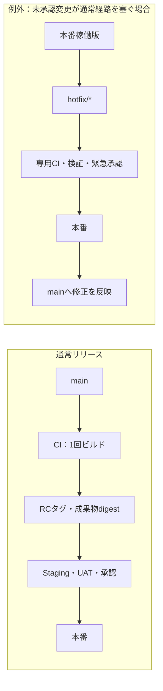

# 日本企業における環境とブランチ戦略の現実解（2026年版）

## 結論：まず押さえる3点

1. **環境は検証目的で決める。** Dev／Staging／QA・UAT／本番の4分類は現場の共通言語として残すが、4つの独立環境を必須とはしない。
2. **ブランチは短命PR＋mainへの頻繁な統合を第一候補とする。** 複数のリリース系列を保守するならreleaseブランチやGitFlow系も選択できる。
3. **成果物の昇格と公開承認を分ける。** 同じ成果物を段階的に検証し、必要な全員承認を記録する。通常のリリースが塞がれる場合に備え、Hotfix専用経路も設計する。

この文書では、筆者が日本企業・SES案件で経験した「現状の記録」と、新規構築・改善時の「推奨」を分ける。現場の実例をすべての案件に当てはめる意図はない。

## 1. 混同しない5つの設計対象

| 対象 | 主に決めること |
| --- | --- |
| 環境 | どこで実装・結合・UAT・本番稼働を行うか |
| ブランチ | 変更をいつ統合し、どの版を並行保守するか |
| 成果物 | 何をビルドし、どの版を配置するか（digest／ハッシュで識別） |
| デプロイ | いつ、どの環境に成果物を配置するか |
| リリース・承認 | いつ誰に機能を公開し、誰が何を承認するか |

環境とブランチは1対1で対応しない。コードレビュー、業務UAT、本番デプロイ承認も別の責務として扱う。

## 2. 環境構成：現場の実態と新規構築の判断

### 現場でよく見られた4環境

| 呼称 | 役割 |
| --- | --- |
| Dev（開発） | 実装・単体テスト・開発者による確認 |
| Staging（検証） | 結合・外部連携・本番相当の確認 |
| QA／UAT（品質・受入） | 品質評価、業務オーナーによる受入テスト |
| 本番（Production） | 実ユーザーへのサービス提供 |

QA／UATは本来テスト活動の名前だが、現場では独立環境の呼称にも使われる。予算や外部連携の制約から、Dev／Staging／本番の3環境、あるいはStaging／本番の2環境で運用する案件もある。

### 新規構築・改善での推奨

「誰が、どの変更を、どの依存関係とデータで確認するか」から環境数を決める。並行UATにはPRプレビューや一時環境が有効で、独立QA環境は分離が必要な場合に設ける。

本番との差分はIaC・設定管理で可視化する。本番データを利用する場合は個人情報を保護し、外部送信・秘密情報を隔離する。

## 3. ブランチ戦略の選択

| 方式 | 向く条件 | 留意点 |
| --- | --- | --- |
| TBD＋短命PRブランチ | 単一の主要本番ライン、頻繁な統合 | 小さな差分、CI、互換性の維持が必要 |
| TBD＋短期releaseブランチ | リリース凍結、限定的な並行保守 | 存続期限と修正の反映先を決める |
| GitFlow系 | 複数系列の長期保守、統合と出荷の周期が異なる | 逆マージ、差分・テストの重複が増える |

TBDを新規案件の第一候補とするが、「世界的な主流」との統計的な断定はしない。[1]

既存のGitFlowには部署間の承認待ちや出荷周期などの事情がある。一方、**ブランチを増やすことは監査の代替にならない。** 承認履歴、テスト結果、変更チケット、成果物、デプロイ履歴を記録して統制する。

## 4. 通常リリースとタグベースの昇格

以下は一つの標準フローである。**タグベース昇格は手順2〜4を具体化する方式**であり、別のブランチ戦略ではない。「Build once, deploy many」の考え方を採用する。[2]

1. `feat/*` や `fix/*` の小さなPRをレビュー・テストし、`main` に統合する。
2. 対象コミットを確定し、候補タグ（例：`v1.4.0-rc.1`）を付与する。CIで一度ビルドし、コミットSHAと成果物digest／チェックサムを記録する。
3. 同じ成果物をStagingへ配置し、結合テストと必要な業務UATを実施する。業務オーナーごとの結果を記録する。
4. 必要な承認が揃ったら、同じコミットを正式タグ（例：`v1.4.0`）で識別し、検証済み成果物を本番へ昇格する。正式タグによる再ビルドは行わない。
5. 公開範囲をFeature Flagなどで制御し、監視する。障害時はロールバックか修正版の前進リリース（fix-forward）を判断する。

タグはソース版の参照名であり、成果物の同一性を単独で保証しない。正式タグ・成果物digest・承認記録・本番配置履歴を対応付ける。タグ保護や不変リリースも有用である。[3]

同じ候補をA／Bオーナーが承認するなら、候補タグを分けずに承認記録を分ける。異なる候補（例：`rc-A202509`、`rc-B202509`）を使うなら、各候補のSHAとdigestを明示し、**最終的に本番へ出す成果物が必要な検収を受けていること**を確かめる。

なお、環境設定をビルド時に埋め込む構成では成果物の共通化が難しい。可能ならランタイム設定へ移し、少なくともビルド条件と配布物を追跡する。

### 通常経路と緊急Hotfix経路

## 5. 共有Stagingと複数オーナーの承認

### 経験した制約

- Dev／Staging／本番の3環境しかなく、複数オーナーがStagingを共有する。
- Aオーナーは承認済みでもBオーナーのUATが未了で、全体のリリースが止まる。
- 監査要件だけでなく、責任分担や関係者の合意形成という日本企業の慣例から全員承認を求められる。
- 通常のStagingには未承認機能が混在し、緊急修正の検証を妨げる。

### 改善できる条件と対応

契約・規程・関係者が変更単位の承認を認めるなら、A機能だけ公開し、B機能は非公開にする運用も可能である。業務UATの承認者と本番デプロイ承認者は分けて記録する。

Feature FlagをOFFにしても、共有DB、共通API、バッチ、副作用、認可の変更まで隔離できるわけではない。[4] 必要なら一時環境や短期releaseブランチで分離する。

全員一括承認が必須なら省略しない。承認する変更セット、担当者、検証結果、保留理由を明確にして待つ。

### GitHub Actionsでの承認設定

- EnvironmentのRequired reviewersには、ユーザーまたはチームを**合計6件まで**指定できる。ただし、そのうち**1人の承認で**ジョブが進むため、全オーナー承認には別の仕組みが必要。[5]
- GitHub Free／Pro／TeamではRequired reviewersとWait timerは公開リポジトリのみ。GitHub.comの非公開リポジトリでこれらの標準保護機能を使う場合、GitHub Enterprise Cloudが必要。[5]
- コードのPRレビューはRulesets／ブランチ保護と必要に応じてCODEOWNERSで管理する。[6]
- Merge Queueは**組織所有の公開リポジトリ**、または**Enterprise Cloudの組織所有・非公開リポジトリ**で利用できる。PRの統合頻度が高い場合に検討する。[7]

## 6. 緊急Hotfixの専用経路

通常の修正は `main` に先に取り込む（trunk-first／upstream-first）。本番版への個別配布が必要なら、同じ修正を本番稼働版から切った `hotfix/*` にcherry-pickする。

ただし、緊急性が高く`main`での先行修正が現実的でない場合は、**本番稼働版から直接Hotfixを作り、後からmainへ確実に反映**する。共有Stagingが未承認機能で塞がる現場では、短命の独立Hotfixパイプラインが有効である。[8]

1. 本番稼働版のコミットSHA、成果物digest、設定・DB互換性を特定する。
2. `main` で修正可能なら先行して修正・検証し、必要な差分を `hotfix/*` に移す。緊急時は本番版から直接修正する。
3. 通常の未承認変更とは分離したCIと検証環境で、修正だけをテストする。
4. 事前合意した緊急承認を取得し、検証済みの同一成果物を本番へ配置して監視する。
5. `main` と保守中の系列への反映を確認し、専用パイプライン・環境・ブランチを終了する。

**専用経路はテストや承認を省く抜け道ではない。** ロールバック時はDB変更、データ更新、外部送信、旧版との互換性も確認する。スキーマ変更にはexpand → migrate → contractなどの段階的な方式を検討する。[9]

## 7. CI/CDとセキュリティ

- `main` への直接pushを制限し、PRレビュー・自動テスト・必要なチェックを通す。
- CI/CDのトークンを最小権限にし、クラウド認証には長命キーよりOIDCなどの短命認証を優先する。[10]
- GitHub.comでは**2026年7月15日以降に新規作成されたリポジトリ**のOIDC `sub` は、所有者・リポジトリの不変IDを含む形式が既定となった。**同日以降の名前変更・移管**も対象。以前からあるリポジトリは自動変更されず、明示的にオプトインできる。信頼ポリシーは実際のclaimを確認して設定する（GitHub Enterprise Serverは対象外）。[11]
- デプロイの排他制御、権限分離、監視、切り戻し条件と責任者を決める。

## 8. 選定チェック

1. 保守する本番版は1系列か、複数か。
2. 誰が何を承認するか。全員一括承認か、変更単位に分けられるか。
3. Stagingで未承認機能や外部連携を安全に隔離できるか。
4. タグ・commit SHA・成果物digest・承認記録・本番版を紐付けられるか。
5. 通常経路が塞がれた際のHotfix検証・承認・本流への取り込み手順はあるか。

---

## 参考資料（2026-11-14確認）

1. [Trunk-Based Development — Introduction](https://trunkbaseddevelopment.com/)
2. [AWS Builder Center — CI/CD Strategy Patterns and Common Pitfalls（Build Once, Deploy Many）](https://builder.aws.com/content/3CRE0sUkv7aQTimJ695xwuSMzOZ/ci-cd-strategy-patterns-and-common-pitfalls)
3. [GitHub Docs — Immutable releases](https://docs.github.com/en/code-security/concepts/supply-chain-security/immutable-releases)
4. [Martin Fowler — Feature Toggles](https://martinfowler.com/articles/feature-toggles.html)
5. [GitHub Docs — Deployments and environments](https://docs.github.com/en/actions/reference/workflows-and-actions/deployments-and-environments)
6. [GitHub Docs — Available rules for rulesets](https://docs.github.com/en/repositories/configuring-branches-and-merges-in-your-repository/managing-rulesets/available-rules-for-rulesets)
7. [GitHub Docs — Managing a merge queue](https://docs.github.com/en/repositories/configuring-branches-and-merges-in-your-repository/configuring-pull-request-merges/managing-a-merge-queue)
8. [AWS Prescriptive Guidance — Automate dynamic pipeline management for deploying hotfix solutions](https://docs.aws.amazon.com/prescriptive-guidance/latest/patterns/automate-dynamic-pipeline-management-for-deploying-hotfix-solutions.html)
9. [Prisma Data Guide — Using the expand and contract pattern](https://www.prisma.io/dataguide/types/relational/expand-and-contract-pattern)
10. [GitHub Docs — Secure use reference](https://docs.github.com/en/actions/reference/security/secure-use)
11. [GitHub Docs — OpenID Connect reference](https://docs.github.com/en/actions/reference/security/oidc)
